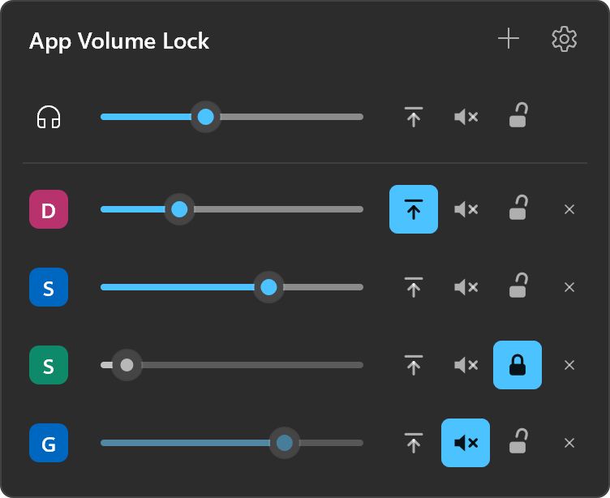
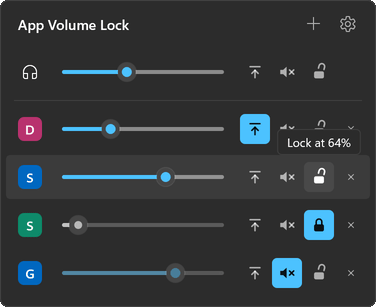
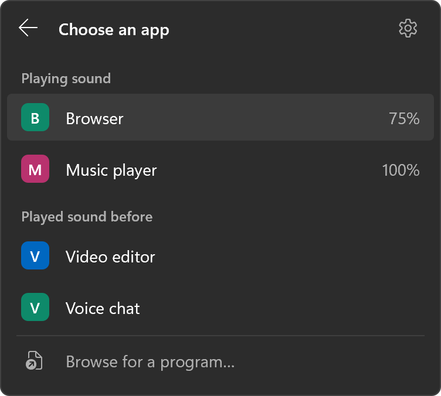
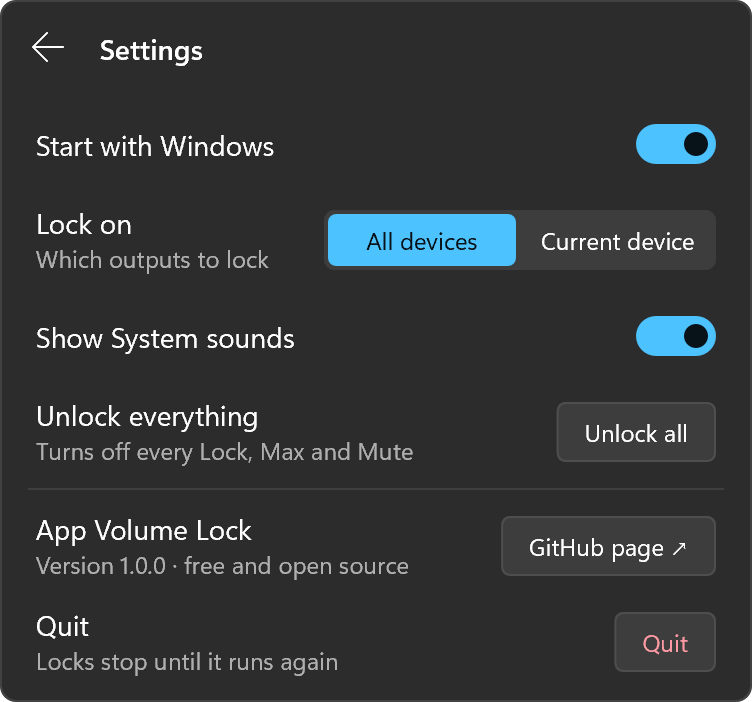

<p align="center"></p>

<h1 align="center">App Volume Lock</h1>

<p align="center">When an app updates, Windows forgets the volume you gave it and it starts at 100 % again.<br>App Volume Lock puts it back, and keeps it where you set it.</p>

<p align="center">
  <a href="https://github.com/noKikoushi/app-volume-lock/releases/latest"></a>
  <a href="LICENSE"></a>
  <a href="https://github.com/sponsors/noKikoushi"></a>
  <a href="https://github.com/noKikoushi/app-volume-lock/issues/new/choose"></a>
  <a href="https://www.reddit.com/submit?url=https://github.com/noKikoushi/app-volume-lock&title=App%20Volume%20Lock%3A%20a%20free%20tray%20app%20that%20keeps%20Windows%20app%20volumes%20where%20you%20set%20them%2C%20even%20after%20updates"></a>
</p>

<p align="center"></p>

## Why

Some apps (Discord, Claude, Medal and others) update themselves into a new folder,
like `app-1.4.2` → `app-1.4.3`. Windows remembers each app's volume by the folder it runs from,
so after an update the app counts as new and starts at 100 % again.

App Volume Lock matches apps by their program name instead, and puts the volume back.

## Features

Each app in the list has three buttons:

| | |
|---|---|
| **Lock** | Keeps this exact volume. The slider is frozen until you unlock it. |
| **Max** | The app may go lower, never above this volume. |
| **Mute** | Keeps the app muted. |

<p align="center"></p>

- Changes are undone within a few milliseconds: Windows reports every volume change and every app that starts playing, so nothing is polled in a loop.
- **System sounds** can be locked too (or hidden).
- Locks apply to every output device, or only to the one in use.
- Shows real app icons and names, like the Volume Mixer.
- Starts with Windows (optional) and stays in the tray.

### Adding an app

Press **+** in the panel. The list shows apps that are playing sound right now, and open apps that
have played sound on this PC before (Windows only lists an app in the Volume Mixer once it has made
a sound, so this catches apps like a recorder that is still quiet). **Browse for a program…** picks
any `.exe`, even one that isn't running.

<p align="center"></p>

### Settings

| Setting | What it does |
|---|---|
| **Start with Windows** | Starts quietly in the tray when you sign in. |
| **Lock on** | *All devices*: every speaker and headset. *Current device*: only the one in use. |
| **Show System sounds** | Shows or hides the System sounds row. Hidden means it's left alone. |
| **Unlock everything** | Turns off every Lock, Max and Mute at once. |

<p align="center"></p>

## How it works

- Every app that makes sound has an **audio session** in Windows; the Volume Mixer shows one slider
  per session. App Volume Lock sets a session's volume and mute through the same API
  (`ISimpleAudioVolume`), and never touches Windows' overall volume.
- Apps are matched by the **start of the program name**, not the folder. A row for `medal` also
  covers `MedalEncoder.exe`, which is where Medal's sound actually comes from. If you add a helper
  program as its own row, the more specific row wins.
- Apps that play through a web view (`msedgewebview2.exe`, used by WhatsApp, Teams and others) are
  traced back to the app that owns them, so they show up under their real name.
- Windows notifies the app when a session appears, when a volume changes and when an output device
  is added or switched. A check every 2 seconds is only a fallback.
- If another program keeps setting the same app to a different volume, App Volume Lock backs off
  for a moment instead of fighting it at full speed.

## FAQ

**Can I lock one browser tab, or one part of an app?**
No. Windows gives several sessions of the same program no stable name, and their IDs change every
time the program restarts, so a per-session lock would be lost after the next update. A row always
covers the whole program.

**What happens while a locked app isn't running?**
Nothing. The lock waits, and applies the moment the app starts playing, before you hear it at 100 %.

**Does it change my settings in other volume tools?**
No, but two tools locking the same app to different levels will keep correcting each other. Lock
an app in one place only.

## Install

1. Download `AppVolumeLock.exe` from the [latest release](https://github.com/noKikoushi/app-volume-lock/releases/latest).
2. Run it. It installs itself for your user (no admin rights, no setup window) and the panel opens
   next to the tray. You can delete the downloaded file afterwards.
3. Press **+**, pick an app, press the padlock.

It's then in the Start menu and in **Settings → Apps**, like any other app. To update, run a newer
download the same way. To remove it, uninstall it from **Settings → Apps**; that also deletes its
settings.

Where things go:

| | |
|---|---|
| Program | `%LOCALAPPDATA%\Programs\App Volume Lock\` |
| Settings | `%APPDATA%\App Volume Lock\settings.json` |

## Requirements

- Windows 11. Windows 10 should work but hasn't been tested; its panel has no see-through background.
- No admin rights, no runtime to install.

## Security and privacy

- **No network.** The app has no network code at all, and it collects nothing.
- **Only the Volume Mixer's API.** It changes app volumes through Windows' own audio API, exactly
  like the Volume Mixer does. It doesn't inject code, read other programs' memory, install drivers
  or hook the keyboard or mouse, so it is safe to run next to games with anti-cheat.
- **Built in the open.** Every release is built from this source by GitHub Actions. The release
  page lists the file's SHA256.
- **Unsigned.** The exe isn't signed with a paid code-signing certificate, so Windows SmartScreen
  may show *Windows protected your PC* the first time. Choose **More info → Run anyway**.

## Why Rust

- One small exe (about 500 KB) with nothing else to install: no .NET, no Electron.
- About 16 MB of memory and practically no CPU while it waits in the tray.
- It talks to Windows' audio API directly, and Rust's checks rule out a whole class of memory bugs.

## Build from source

Needs [Rust](https://rustup.rs).

```
git clone https://github.com/noKikoushi/app-volume-lock
cd app-volume-lock
cargo build --release
```

The exe is `target\release\AppVolumeLock.exe`.

## Contributing

Bug reports and pull requests are welcome. See [CONTRIBUTING.md](CONTRIBUTING.md).

## Credits

- [windows-rs](https://github.com/microsoft/windows-rs) by Microsoft, for the Windows APIs
- [serde](https://serde.rs) and serde_json, for the settings file
- [embed-resource](https://github.com/nabijaczleweli/rust-embed-resource), for the icon and version info
- Icons in the panel come from the Segoe Fluent Icons font that ships with Windows

## License

[GPL-3.0](LICENSE). You may use, change and share it; changed versions must stay open source under the same license.
